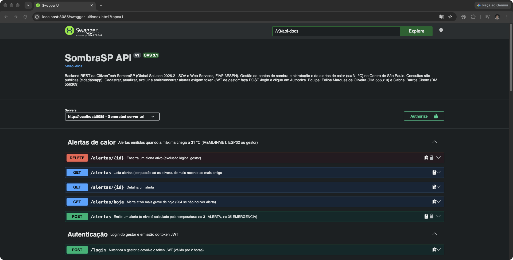

# SombraSP · API de SOA e Web Services

Global Solution 2026.2 · FIAP · Engenharia de Software · Turma **3ESPH**

Backend REST da CitizenTech **SombraSP**. Gerencia os pontos de sombra e hidratação, os parceiros que os mantêm e os alertas de calor (máxima ≥ 31 °C) no Centro de São Paulo. Expõe as consultas que o app do cidadão usa, como os pontos mais próximos e o alerta de hoje.

## Integrantes

| Nome completo | RM | Turma |
|---|---|---|
| Felipe Marques de Oliveira | 556319 | 3ESPH |
| Gabriel Barros Cisoto | 556309 | 3ESPH |

## Ficha da CitizenTech

| Campo | Valor |
|---|---|
| **Nome** | SombraSP |
| **Cidade e bairro** | São Paulo, Centro (Sé e República) |
| **Cidadão beneficiado** | Idosos e trabalhadores de rua (ambulantes, entregadores, garis) expostos ao sol |
| **Problema, em uma frase** | Nos dias de calor extremo, quem passa o dia na rua não recebe aviso a tempo nem sabe onde encontrar sombra e água por perto. |
| **Como funciona** | Sensores (ESP32) e dados meteorológicos públicos (INMET) estimam o risco de calor. Quando o risco sobe, a plataforma emite alertas e mostra pontos de sombra e hidratação próximos. |
| **O que cada parte faz** | **SOA (este repositório):** backend REST de gestão de pontos de apoio, parceiros e alertas, com busca por proximidade, JWT, Flyway e Swagger. **C#:** API de fotos dos pontos (bytes no SQL Server) e distribuição transacional de kits de água. **Mobile:** app Expo em que o cidadão vê o alerta e os pontos próximos. **Cybersecurity:** detecção de dados sensíveis e painel de Risco Cidadão. **IA&ML:** prevê na véspera, com dados reais do INMET (estação A701), se a máxima passará de 31 °C. **Physical Computing:** estação ESP32 (Wokwi) mede temperatura e umidade e aciona alerta local. **Operating Systems:** infraestrutura Linux que hospeda a aplicação, com monitoramento. **Testing:** features e casos de teste no Azure Boards. |
| **Indicador de impacto** | Nº de alertas emitidos em dias de risco e nº de consultas a pontos de sombra e hidratação |
| **ODS conectados** | ODS 3 (Saúde e bem-estar), ODS 10 (Redução das desigualdades), ODS 11 (Cidades sustentáveis), ODS 13 (Ação contra a mudança do clima) |

## O que esta API faz

- **Pontos de apoio:**
  - CRUD de pontos de sombra, hidratação ou ambos, com endereço, coordenadas, acessibilidade, horário e parceiro responsável;
  - exclusão lógica;
  - listagem paginada com filtros por tipo, bairro e acessibilidade.
- **Pontos próximos:** `GET /pontos/proximos?latitude&longitude&raioKm` devolve os pontos ativos dentro do raio, do mais perto para o mais longe. A distância é calculada pela fórmula de Haversine. É a consulta que o app usa no dia de calor.
- **Alertas de calor:**
  - emissão com o nível calculado pela temperatura: ≥ 31 °C é `ALERTA` e ≥ 35 °C é `EMERGENCIA`;
  - regras de negócio em validadores próprios: abaixo de 31 °C não há alerta; data passada ou mais de 7 dias à frente é recusada; não pode haver dois alertas ativos da mesma fonte no mesmo dia;
  - encerramento (exclusão lógica);
  - `GET /alertas/hoje`, que devolve o alerta mais grave do dia.
- **Parceiros:** CRUD do poder público, do comércio e das ONGs que mantêm os pontos. Um parceiro com pontos ativos não pode ser excluído.
- **Segurança:** consultas abertas para o cidadão. Cadastrar, alterar, excluir, emitir e encerrar exigem **token JWT de gestor**.

## Arquitetura e estrutura do domínio

Organização em camadas, no mesmo padrão trabalhado em aula (CP4 e Sprint 3):

```
src/main/java/br/com/fiap3esph/sombrasp
├── controller/        → REST: PontoApoio, AlertaCalor, Parceiro, Autenticacao, HealthCheck
├── service/           → regras de aplicação e transações (@Transactional)
├── domain/
│   ├── ponto/         → PontoApoio (entidade), TipoPonto, CalculadoraDistancia, repository, records Dados*
│   ├── alerta/        → AlertaCalor, NivelAlerta, FonteAlerta, repository, records Dados*
│   │   └── validacao/ → ValidadorEmissaoAlerta (Strategy) + 3 validadores
│   ├── parceiro/      → Parceiro, TipoParceiro, repository, records Dados*
│   ├── endereco/      → Endereco (@Embeddable) + DadosEndereco
│   ├── usuario/       → Usuario (UserDetails), Perfil, repository, DadosLogin
│   └── exception/     → RecursoNaoEncontrado (404), RegraDeNegocio (422), Conflito (409)
└── infra/
    ├── security/      → SecurityConfig, SecurityFilter (JWT), TokenService, RestSecurityHandler (401/403)
    ├── exception/     → GlobalExceptionHandler (respostas JSON em português)
    ├── openapi/       → OpenApiConfig (Swagger com esquema bearer-jwt)
    └── config/        → RelogioConfig (fuso America/Sao_Paulo)
```

**Modelo de dados (MySQL):**

```
parceiros (1) ───< (N) pontos_apoio          alertas_calor          usuarios
  id, nome, tipo,        id, nome, tipo, descricao,    id, data_referencia,   id, nome, login,
  email (unique),        latitude, longitude,          temperatura_maxima,    senha (BCrypt),
  telefone, ativo        acessivel, horario,           nivel, fonte,          perfil
                         endereço (embutido),          mensagem, ativo,
                         parceiro_id (FK), ativo       emitido_em, encerrado_em
```

## Banco de dados e migrações (Flyway)

O banco é **MySQL 8.4**, e a estrutura é criada e versionada **somente pelo Flyway** (`spring.jpa.hibernate.ddl-auto=none`):

| Versão | Arquivo | O que faz |
|---|---|---|
| V1 | `V1__create-table-parceiros.sql` | Tabela de parceiros |
| V2 | `V2__create-table-pontos-apoio.sql` | Tabela de pontos, com FK para parceiros |
| V3 | `V3__create-table-alertas-calor.sql` | Tabela de alertas |
| V4 | `V4__create-table-usuarios.sql` | Tabela de usuários (login do gestor) |
| V5 | `V5__alter-table-alertas-calor-add-column-encerrado-em.sql` | Evolução do esquema: data de encerramento do alerta |
| V6 | `V6__inserir-dados-iniciais.sql` | Carga inicial: 3 parceiros, 4 pontos na Sé/República, 2 alertas e o usuário gestor de demonstração |

Os dados são fictícios ou públicos: nomes de praças e coordenadas aproximadas. Não há nenhum dado pessoal real.

## Endpoints

Documentação interativa (Swagger UI): **http://localhost:8085/swagger-ui.html** · OpenAPI: `/v3/api-docs`

| Método | Rota | Acesso | Descrição |
|---|---|---|---|
| POST | `/login` | público | Login do gestor; devolve `{token, tipo, expiraEmSegundos}` |
| GET | `/health-check` | público | API no ar |
| GET | `/pontos?tipo=&bairro=&acessivel=&page=&size=&sort=` | público | Lista paginada de pontos ativos |
| GET | `/pontos/proximos?latitude=&longitude=&raioKm=1&tipo=&acessivel=` | público | Pontos dentro do raio, ordenados pela distância |
| GET | `/pontos/{id}` | público | Detalhe do ponto |
| POST | `/pontos` | gestor | Cadastra ponto (201 + `Location`) |
| PUT | `/pontos` | gestor | Atualiza ponto (id no corpo) |
| DELETE | `/pontos/{id}` | gestor | Exclusão lógica (204) |
| GET | `/alertas?ativos=true` | público | Lista paginada de alertas |
| GET | `/alertas/hoje` | público | Alerta mais grave de hoje (200) ou 204 |
| GET | `/alertas/{id}` | público | Detalhe do alerta |
| POST | `/alertas` | gestor | Emite alerta, com o nível calculado (201) |
| DELETE | `/alertas/{id}` | gestor | Encerra o alerta (204; se já estiver encerrado, 409) |
| GET | `/parceiros`, `/parceiros/{id}` | público | Lista e detalhe de parceiros |
| POST · PUT · DELETE | `/parceiros` | gestor | Cadastro, atualização e exclusão lógica |

**Respostas de erro (JSON em português):**

| Código | Quando |
|---|---|
| 400 | Validação, com a lista `campos` |
| 401 | Sem token ou credenciais inválidas |
| 403 | Perfil sem permissão |
| 404 | Recurso inexistente |
| 409 | Conflito (duplicado, já encerrado) |
| 422 | Regra de negócio |
| 503 | Banco indisponível |

**Conta de demonstração (gestor):** criada pela migration V6, só para testes locais.
- Login: `gestor@sombrasp.dev`
- Senha: `Gestor@SombraSP2026`

No Swagger, faça `POST /login`, copie o `token` e clique em **Authorize**.

## Como executar

Pré-requisitos:
- **Java 25**;
- **Docker** (para o MySQL);
- o Maven não precisa estar instalado, porque o projeto usa o wrapper `mvnw`.

```bash
# 1. Variáveis locais (o .env não vai para o Git)
cp .env.example .env          # edite as senhas

# 2. Banco MySQL 8.4
docker compose up -d          # container "sombrasp-mysql" na porta 3306

# 3. API (o Flyway cria as tabelas e a carga inicial na primeira execução)
export $(grep -v '^#' .env | xargs)
./mvnw spring-boot:run        # http://localhost:8085/swagger-ui.html
```

No Windows (PowerShell):

```powershell
docker compose up -d
$env:DB_PASSWORD = "<a mesma senha do .env>"; $env:JWT_SECRET = "<segredo do .env>"
.\mvnw.cmd spring-boot:run
```

Variáveis lidas pela aplicação:
- `DB_URL`: padrão `jdbc:mysql://localhost:3306/sombrasp`;
- `DB_USER`: padrão `sombrasp`;
- `DB_PASSWORD`;
- `JWT_SECRET`.

## Testes automatizados

```bash
./mvnw test     # não precisa do MySQL: usa H2 em memória (modo MySQL) com as MESMAS migrations
```

São **50 testes** em três níveis:

| Tipo | Classes | O que cobrem |
|---|---|---|
| Unitários do domínio | `NivelAlertaTest`, `CalculadoraDistanciaTest` | Nível do alerta por temperatura (limiares 31 e 35 °C), Haversine, tipos de ponto |
| Controller (`@WebMvcTest` + Mockito) | `PontoApoioControllerTest`, `AlertaCalorControllerTest` | Códigos HTTP, `Location`, validação (400), 404, 422 e 204, com o serviço simulado |
| Integração (`@SpringBootTest` + H2 + Flyway) | `AutenticacaoIntegracaoTest`, `PontoApoioIntegracaoTest`, `AlertaCalorIntegracaoTest`, `ParceiroIntegracaoTest`, `InfraestruturaIntegracaoTest` | Login JWT e 401; CRUD completo; filtros; pontos próximos; regras dos alertas (422/409); exclusão lógica; Flyway aplicou V1–V6; OpenAPI e Swagger publicados |

Resultado da última execução: [`docs/evidencias/testes_automatizados.txt`](docs/evidencias/testes_automatizados.txt), com 50 testes, 0 falhas e BUILD SUCCESS.

## Evidências da aplicação

Executado em 18/11/2026 contra o **MySQL 8.4 real** (container Docker).

| Arquivo | O que mostra |
|---|---|
| [`docs/evidencias/01_swagger_ui_documentacao.png`](docs/evidencias/01_swagger_ui_documentacao.png) | Swagger UI gerado automaticamente: título, descrição, equipe e Authorize (JWT) |
| [`docs/evidencias/02_swagger_ui_rotas.png`](docs/evidencias/02_swagger_ui_rotas.png) | Rotas documentadas, com cadeado nas operações de gestor |
| [`docs/evidencias/03_pontos_proximos_json.png`](docs/evidencias/03_pontos_proximos_json.png) | `GET /pontos/proximos` a partir da Praça da Sé: pontos ordenados por distância (0,0 km, 0,25 km e 0,543 km) |
| [`docs/evidencias/roteiro_api_mysql.txt`](docs/evidencias/roteiro_api_mysql.txt) | Roteiro completo (`scripts/demonstrar-api.sh`): versões do Flyway no MySQL, consultas públicas, 401 sem token, login, CRUD (400/404/201/200/204/404), exclusão lógica conferida no banco, regras dos alertas (422/201/409/422/204/409) e **banco parado → 503**, depois religado → 200. Resultado: **0 divergências** |
| [`docs/evidencias/console_execucao_mysql.log`](docs/evidencias/console_execucao_mysql.log) | Console da aplicação: Flyway "Successfully applied 6 migrations", seguido da inicialização |
| [`docs/evidencias/testes_automatizados.txt`](docs/evidencias/testes_automatizados.txt) | Saída do `mvn test` |



## Tecnologias

- Java 25 e Spring Boot 4.0.5 (Web MVC, Data JPA, Validation, Security);
- MySQL 8.4 e Flyway;
- Auth0 java-jwt 4.6.0;
- springdoc-openapi 3.1.1 (Swagger UI);
- Lombok;
- JUnit 5, Mockito, MockMvc e H2 (testes);
- Docker Compose.
